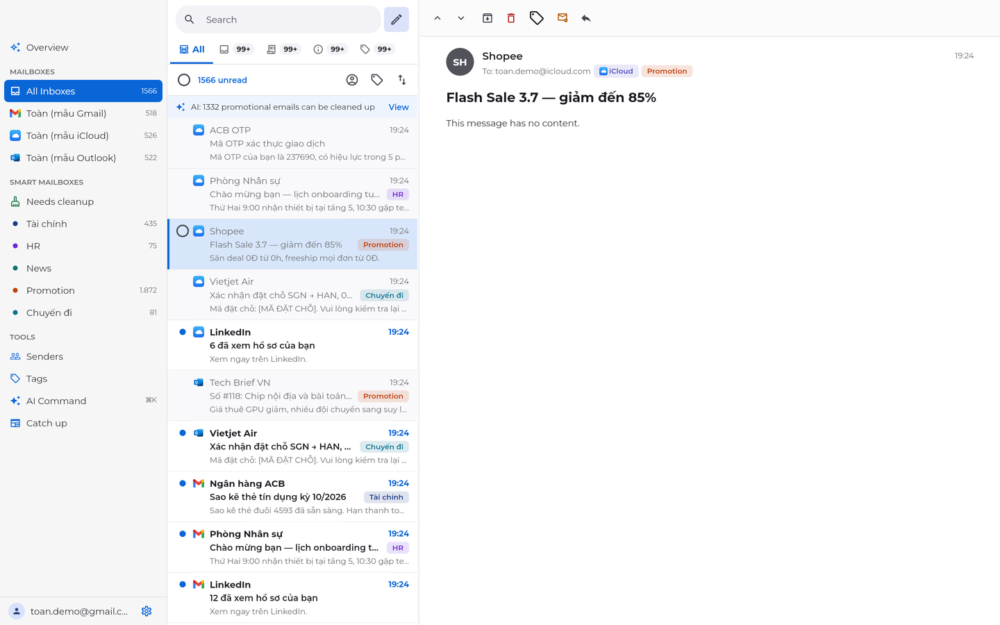
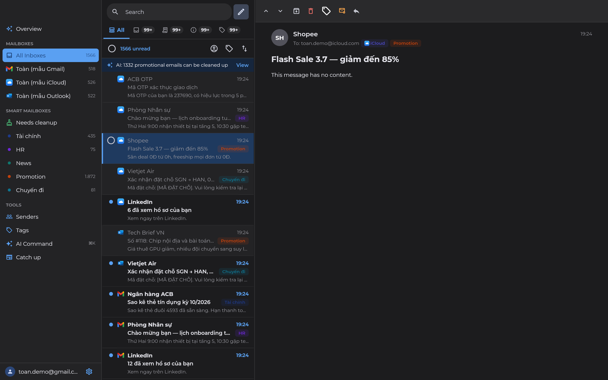
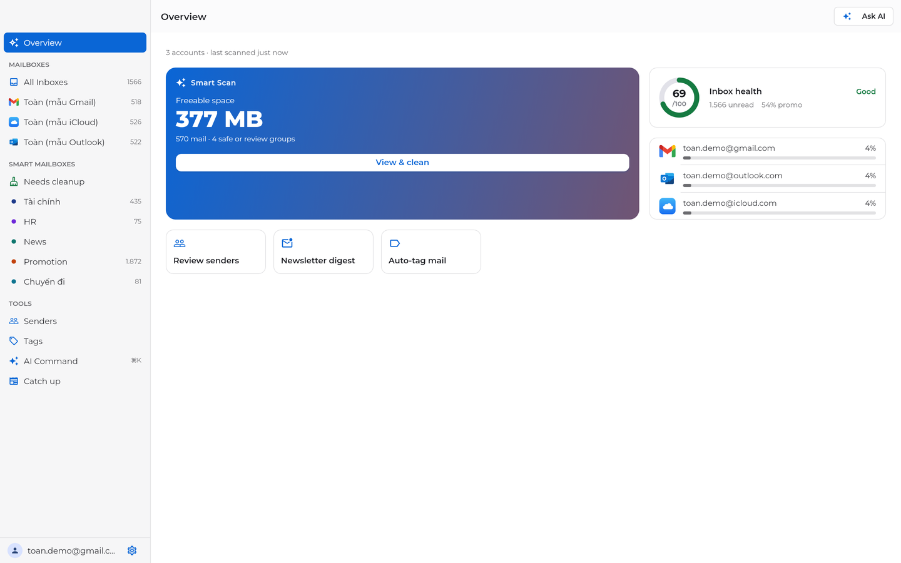
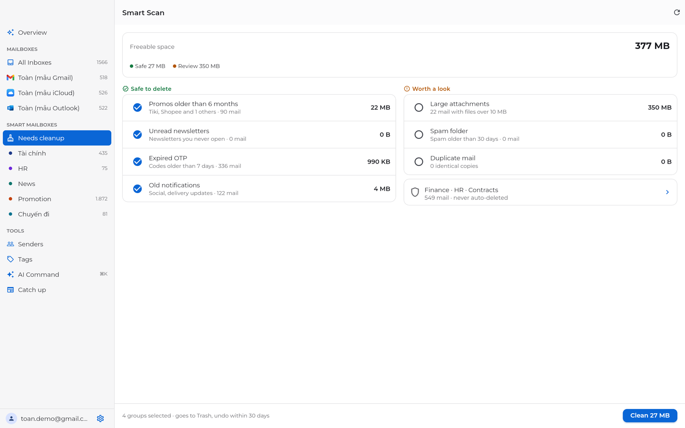
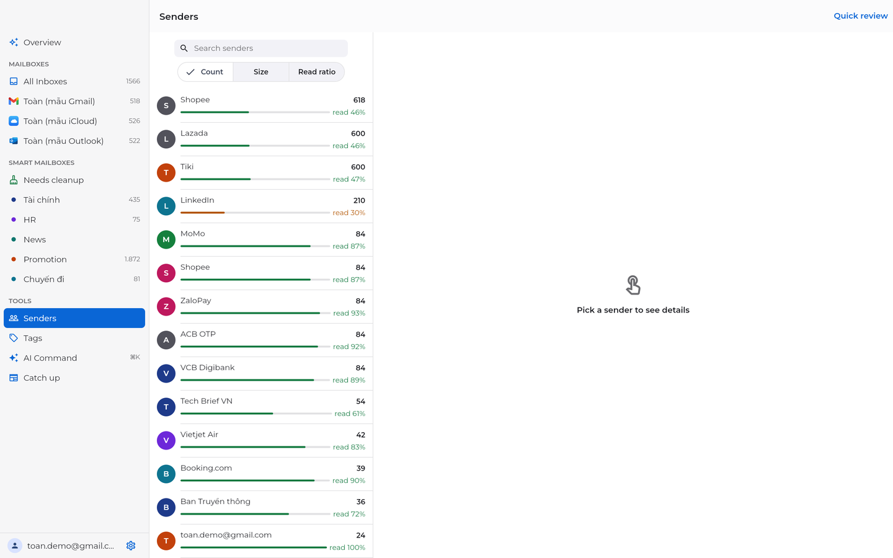
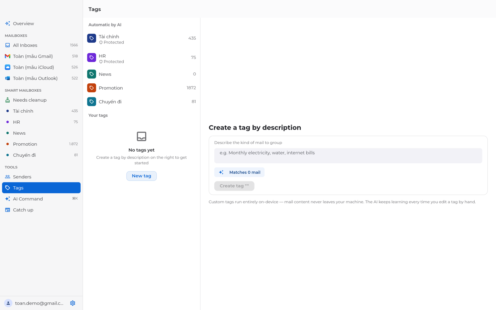

# AI Smart Mail

**One inbox for Gmail, Outlook and iCloud — with an assistant that cleans it up for you, on your device.**

Built with Flutter. macOS app and web app today; iOS and Android share the same core and are next.

| | |
|---|---|
| **Live web app** (connect your real mailboxes) | https://fluttermailcleaner.vercel.app |
| **Demo** (sample data, nothing to sign in) | https://noattoan.github.io/flutter_mail_cleaner/ |



---

## Why

Most people have several mailboxes, and each one is slowly filling up with promotions, expired OTP codes and newsletters nobody reads. Existing cleaners are web-only, subscription-heavy, or pay for themselves by selling your mail data.

AI Smart Mail takes the opposite stance:

- **Your mail stays on your machine.** Headers, bodies and the search index live in a local database. Classification, tagging and summaries run on-device.
- **The AI suggests, you decide.** Nothing is deleted without your approval, every action says *why*, and every action can be undone.
- **Protected by default.** Banking, invoices, HR and contracts are never offered for deletion.

## Product review

### Unified inbox

All accounts in one list, Apple Mail style: sidebar · message list · reading pane. You can filter by account, category (Primary, Transactions, Updates, Promotions) or smart mailbox, and sort by date, unread first, sender or size.

- Keyboard-first: `↑`/`↓` to move (the list follows the selection), `E` to archive, `⌫` to trash, `⌘Z` to undo, `⌘K` for AI Command.
- Multi-select with ⌘/⇧-click and bulk actions. Swipe actions on touch.
- New mail that arrives while you're scrolled down waits behind an "N new" pill instead of shifting the rows you're reading.
- Infinite scroll over local data, so even 100k-message mailboxes stay smooth.
- Compose and reply over SMTP.

<p>
  
</p>

### Overview & inbox health

A score out of 100 for the inbox (unread load, share of promotions), storage per account, and how much space a cleanup would free, all on one screen.



### Smart Scan

Think CleanMyMac, for email. Mail is grouped into **Safe to delete** (old promos, unread newsletters, expired OTP codes, old notifications) and **Worth a look** (large attachments, spam, duplicates). Safe groups are pre-selected, and protected mail is counted separately and never touched. One click moves everything to Trash, and you can undo it for 30 days.



### Senders

Every sender ranked by volume, size and **how often you actually read them**. A sender you open 30% of the time is a strong unsubscribe candidate. You can unsubscribe in one click (RFC 8058 / `mailto:`), archive everything from a sender, or triage them quickly in a swipe-style review.



### Tags

Automatic multi-label tagging (Finance, HR, News, Promotion, Travel), plus custom tags you **describe in plain words**, e.g. "monthly electricity, water and internet bills". You see how many messages match before creating the tag. Matching is accent-insensitive, so it works for Vietnamese.



### Also inside

- **AI Command (`⌘K`)**: type "trash all Shopee mail older than 3 months except invoices". It's parsed into a filter you preview before anything runs.
- **Catch up**: summarises a backlog of unread newsletters, de-duplicating repeated stories.
- **AI summary card** on long messages, with a "runs on device" badge.
- **Undo history** for every action, single or bulk.
- **Vietnamese and English**, light and dark themes, layouts from phone to wide desktop.

## Honest status

| Area | State |
|---|---|
| macOS app | Working. Real IMAP sync (Gmail/Outlook OAuth, iCloud app password, any IMAP server), SMTP send. |
| Web app (Vercel) | Working. IMAP/SMTP go through a small stateless bridge (`api/mail.js`) because browsers can't open mail sockets. Credentials are sent per request and never stored server-side. See [OAUTH_WEB.md](mail_cleaner/docs/OAUTH_WEB.md). |
| Web demo (GitHub Pages) | Static build with three seeded sample mailboxes. No sign-in, and everything stays in your browser (IndexedDB). |
| AI | On-device only: rule-based classifier with a Vietnamese-aware keyword/domain dictionary, TF-IDF summariser, and a natural-language → filter-DSL parser. **No cloud LLM yet.** That is planned as opt-in, with PII removed first. |
| iOS / Android | Core logic is shared. Mobile layouts exist; store builds aren't done yet. |
| Google verification (CASA) | Not started. Gmail OAuth only works for test users until then. |

## Under the hood

- **Flutter 3.47** · Dart 3.13 · Material 3, with all styling in one theme (`lib/core/theme`). Montserrat is bundled.
- **Riverpod 3** (codegen) for state · **go_router** for deep-linkable routes · **drift** (SQLite; WASM + IndexedDB on web) for the local store with FTS search.
- **freezed / json_serializable** for models · **enough_mail** for IMAP/SMTP on desktop · `imapflow` + `nodemailer` in the web bridge.
- Feature-sliced layout: `lib/core` (sync engine, mail providers, AI, actions/undo, DB) + `lib/features/<feature>/{data,domain,presentation}`.
- ~300 unit and widget tests (`flutter test`), plus CI on macOS.

## Run it

```bash
cd mail_cleaner
flutter pub get

# macOS app with sample data
flutter run -d macos --dart-define=DEMO_SEED=true

# Web, with sample data
flutter run -d chrome --dart-define=DEMO_SEED=true
```

Real accounts on macOS need OAuth client IDs. See [OAUTH_GOOGLE.md](mail_cleaner/docs/OAUTH_GOOGLE.md). Releasing a signed, notarised macOS build: [RELEASE_MACOS.md](mail_cleaner/docs/RELEASE_MACOS.md).

## Deployments

- **Vercel** (full web app): `vercel.json` at the repo root runs `mail_cleaner/scripts/build_web.sh` and serves the `api/` functions.
- **GitHub Pages** (demo): `.github/workflows/pages.yml` builds with `DEMO_SEED=true` on every push to `main`.

## Docs

- [Product brief](mail_cleaner/docs/PRODUCT.md): positioning, competitors, personas, 25 use cases, roadmap
- [Tech spec](mail_cleaner/docs/TECH_SPEC.md): architecture, sync engine, data model, AI pipeline, compliance
- [Design mockups](mail_cleaner/design/): 15 iOS + 15 macOS screens
